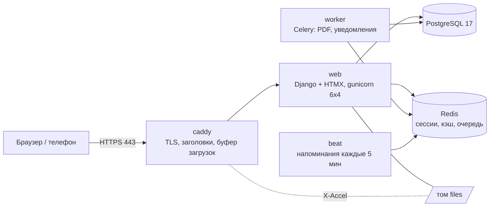

# «Зачётка»: план разработки

> Концепт для конкурса «Цифровой деканат будущего». Это markdown-двойник обзорной страницы `overview.html`.
> Обе версии ведутся руками: правишь одну — поправь и другую.

Личный кабинет студента, преподавателя и администратора. Разрабатываем с 4 по 22 ноября втроём, у каждого свой Claude Code.
Сайт живёт на своём VPS и работает до 28 ноября. Подробности по каждому разделу — в файлах `01_…07_` этой папки.

| 19 | 6 | 75 | 3 | 300 RPS |
|---|---|---|---|---|
| дней | этапов | задач в бэклоге | роли в системе | цель, p95 < 300 мс |

## Роадмап

Ядро конкурса готово к 12.11, раньше «вау». 19.11 вечером заморозка функций.
8.11 в 19:00 открывается приём работ, сразу отправляем черновик.

```text
                     Ср Чт Пт Сб Вс Пн Вт Ср Чт Пт Сб Вс Пн Вт Ср Чт Пт Сб Вс
                     04 05 06 07 08 09 10 11 12 13 14 15 16 17 18 19 20 21 22
S0 Старт             ██ ██ ·· ·· ·· ·· ·· ·· ·· ·· ·· ·· ·· ·· ·· ·· ·· ·· ··
S1 Скелет            ·· ·· ██ ██ ██ ·· ·· ·· ·· ·· ·· ·· ·· ·· ·· ·· ·· ·· ··
S2 Ядро              ·· ·· ·· ·· ·· ██ ██ ██ ██ ·· ·· ·· ·· ·· ·· ·· ·· ·· ··
S3 Преп. + админ     ·· ·· ·· ·· ·· ·· ·· ·· ·· ██ ██ ██ ██ ·· ·· ·· ·· ·· ··
S4 Вау + полировка   ·· ·· ·· ·· ·· ·· ·· ·· ·· ·· ·· ·· ·· ██ ██ ██ ·· ·· ··
S5 Тесты + выпуск    ·· ·· ·· ·· ·· ·· ·· ·· ·· ·· ·· ·· ·· ·· ·· ·· ██ ██ ██
Демо                    ◆        ◆           ◆           ◆        ◆        ◆
```

Выходные: 7–8, 14–15, 21–22.11; 4.11 — праздник.

## Команда

Монолит делим по слоям, у каждого слоя своя папка-модуль: `core/`, `domain/`, `web/` и общий `tests/`. Контракт между B и C — сигнатуры сервисов с заглушками, поэтому C не ждёт реализации.

| | A — Платформа и качество (Никита) | B — Учебная логика (участник 2) | C — Интерфейс и продукт (участник 3) |
|---|---|---|---|
| Делает | Django-каркас, `CLAUDE.md`, агенты и хуки · VPS, Docker Compose, Caddy, CI/CD · вход, сессии, права, аудит · экраны админки и статистика · матрица прав, E2E, k6, ZAP · отчёты по безопасности и нагрузке | Модели, миграции, сидер · сервисный контракт для C · расписание, переносы, конфликты · курсы, ДЗ, политики опоздания · оценки, учебный план, справки PDF+QR · Celery: напоминания, уведомления | Опрос студентов, разбор старого ЛК · дизайн-система на Tailwind, логотип · views, шаблоны и HTMX-фрагменты · мобильная версия, PWA, тёмная тема · доступность, Lighthouse, E2E · видео и сборка PDF для жюри |
| Зона кода | `core/` (settings, users, права, вход, аудит, adminpanel) · `tests/` (каркас, `core/`, `authz/`, `e2e/`, `load/`) · `infra/` `scripts/` `.github/` `.claude/` | `domain/`: models, services, selectors, dto, forms, tasks · `domain/org` · `domain/seed` · `tests/domain/` | `web/`: views, urls, `templates/`, `static/` · `tests/web/` · `docs/screens/` |

Личные планы: [plan_A.md](plan_A.md), [plan_B.md](plan_B.md), [plan_C.md](plan_C.md).

## Архитектура

Монолит на Django. Наружу открыты только 80 и 443. `web`, `worker` и `beat` собраны из одного образа.



| Слой | Выбор | Почему не другое |
|---|---|---|
| Ядро | Python 3.13, Django 5.2 LTS, gunicorn | Вход, сессии, CSRF, формы, права и миграции из коробки. FastAPI + React потребовал бы второй язык, контракт OpenAPI и самописный вход. |
| Интерфейс | Django-шаблоны, HTMX, Tailwind (CLI без Node), Alpine CSP | Фрагменты HTML без перезагрузки, JS почти нет. NiceGUI и Reflex держат состояние каждой вкладки на сервере и плохо масштабируются. |
| Данные | PostgreSQL 17, Redis 7 | Данные реляционные. Сессии `cached_db`: скорость Redis, и сессии переживают его перезапуск. |
| Фон | Celery + Beat через Redis, WeasyPrint | RabbitMQ не нужен: сдача ДЗ синхронная, а фоновые задачи Redis тянет. Переход — одна настройка. |
| Инфра | Docker Compose, Caddy, GitHub Actions, GHCR | Kubernetes на одном VPS избыточен. Cloudflare не берём ради доступа из РФ без VPN. |

## VPS

4 vCPU / 8 ГБ / 80 ГБ NVMe в Москве. Timeweb Cloud: ~2–5 тыс. ₽/мес, цену проверить в кабинете.

| Контейнер | RAM |
|---|---|
| ОС + Docker | 600 МБ |
| caddy | 128 МБ |
| web | 1,5 ГБ |
| worker | 768 МБ |
| beat | 128 МБ |
| postgres | 2 ГБ |
| redis | 384 МБ |
| мониторинг | 640 МБ |
| **свободно** | **~1,9 ГБ** |

- Приложение занимает ~4,9 ГБ, мониторинг ещё 0,6 ГБ, остальное — кэш PostgreSQL и всплески.
- **4 ГБ мало:** под нагрузочным тестом начнётся swap, и цифры потеряют смысл.
- Каждый вход тратит 19 МиБ на argon2id. У Django по умолчанию было бы 100 МиБ, поэтому хешер свой, а одновременных хешей не больше 24 по числу потоков gunicorn.

| Нагрузка | Значение | Откуда |
|---|---|---|
| Пользователей | 15 000 | ~10 тыс. очных студентов + преподаватели + запас |
| Одновременно в пик | 3 000 | утро перед первой парой |
| Устойчиво / пики | 300 / 500 RPS | 1 запрос на активного раз в 10 с |
| Сдача ДЗ в последний час | ≈70 Мбит/с | 500 × 5 МБ за 5 минут |

## Безопасность

Главный риск — view без проверки прав, написанный ИИ. Ловим его автоматикой, а не внимательностью.

**Права**
- `LoginRequiredMiddleware` по умолчанию, у каждого view `@require_perm`, а тест-сторож падает, если его нет.
- Матрица «роль × URL × свой/чужой × GET/POST/HTMX» в CI блокирует merge.
- Чужой объект отдаёт 404, а не 403.
- Субагент `security-reviewer` смотрит каждый PR.

**Вход**
- argon2id со своим хешером (19 МиБ, t=2, p=1).
- Cookie `__Host-sessionid`: HttpOnly, Secure, SameSite.
- CSRF Django с токеном в `hx-headers`, django-axes по логину (вуз сидит за одним NAT).
- Админ: 8-часовая сессия, аудит, опционально TOTP.

**Файлы и PDF**
- Проверка сигнатуры, а не только расширения; хранение вне веб-корня.
- Отдача только после проверки прав, attachment + nosniff.
- У WeasyPrint свой `url_fetcher`, чтобы закрыть SSRF.

**Сервер**
- SSH только по ключам, ufw 22/80/443, fail2ban.
- БД и Redis без портов наружу, контейнеры не от root.
- Секреты только в `.env` на сервере, gitleaks.
- Ночной `pg_dump` и проверенное восстановление.

Меры по категориям OWASP Top 10:2025 и чек-лист перед сдачей — в [03_security.md](03_security.md).

## Тесты и CI

В прод едет тот же образ, что прошёл staging.

```text
PR: ruff · djlint · pytest · authz · check --deploy · gitleaks · pip-audit
  → merge: сборка образа · Trivy
  → staging: деплой · Playwright 360px · axe · ZAP
  → тег v*: прод · smoke
```

| Сценарий k6 | Профиль | Порог |
|---|---|---|
| morning_rush | 0 → 2000 VU за 5 мин | p95 < 300 мс, ошибок < 0,5 % |
| grades_published | 0 → 1500 VU за 30 с | p95 < 500 мс |
| deadline_rush | 500 VU, файлы 2–10 МБ | p95 загрузки < 1 с |
| stress / soak / scale_out | до отказа / 1 ч / две копии web | потолок RPS, утечки, отсутствие состояния в web |

## Файлы плана

| Файл | Что внутри |
|---|---|
| [01_product.md](01_product.md) | Проблема, разбор старого ЛК, роли, функционал по MoSCoW, экраны |
| [02_architecture.md](02_architecture.md) | Стек, отвергнутые варианты (FastAPI + React, RabbitMQ), слои, URL-карта, структура репозитория |
| [03_security.md](03_security.md) | Модель угроз, OWASP → меры, сессии, файлы, чек-лист |
| [04_infra.md](04_infra.md) | Расчёт RAM, CPU и диска, провайдеры, деплой и откат |
| [05_quality.md](05_quality.md) | Пирамида тестов, k6, CI/CD, Definition of Done |
| [06_team_roadmap.md](06_team_roadmap.md) | Роли, этапы, ритуалы, Claude, риски |
| [07_backlog.md](07_backlog.md) | 75 задач с владельцем, датами и блокерами, генерируется из трекера |
| `plan_A/B/C.md` и `.html` | Личные планы, генерируются |
| [../../tracker/STATUS.md](../../tracker/STATUS.md) | Текстовый срез Excel-трекера: прогресс, функционал, блокеры, Гант |
